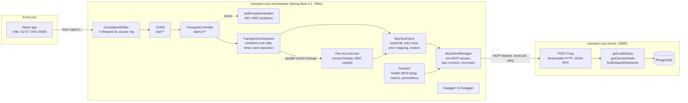
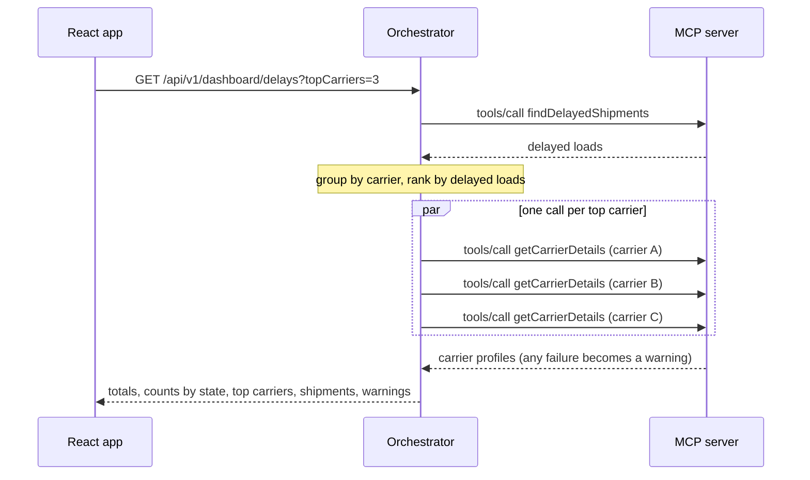

# Transport MCP orchestrator

[](https://github.com/mr-mtd/springboot_mcp_orchestrator/actions/workflows/build.yml)


A Spring Boot service that sits between a React front end and the
[transport MCP server](https://github.com/mr-mtd/springboot_MCP_server). It is an
[MCP](https://modelcontextprotocol.io) client of that server: it calls the server's tools over
Streamable HTTP and serves the results as a plain REST API with CORS, combining several tool calls
where a page needs them (a load with its carrier, a delay dashboard).

- Java 21, Spring Boot 4.2, MCP Java SDK 2.2 (the same SDK the MCP server runs on)
- Listens on port `8081` by default; the MCP server defaults to `8080`
- REST API under `/api/v1`, Swagger UI at `/swagger`, metrics at `/actuator/prometheus`

## Architecture



A request for the delay dashboard, for example:



## REST API

All endpoints are `GET` and return JSON. Input is checked by the orchestrator first, so bad input
is a `400` without an MCP call, and the MCP server checks it again.

| Endpoint | MCP calls | Returns |
| --- | --- | --- |
| `/api/v1/loads/{loadNumber}` | `getLoadStatus` | Load status (`LD-000420` or `420`) |
| `/api/v1/loads/{loadNumber}/overview` | `getLoadStatus`, then `getCarrierDetails` | `{ load, carrier, warnings }`. If the carrier lookup fails, the load still comes back with a warning |
| `/api/v1/carriers/{carrierId}` | `getCarrierDetails` | Carrier profile and 90-day performance |
| `/api/v1/carriers?mcNumber=MC155433` | `getCarrierDetails` | Same, by MC number |
| `/api/v1/shipments/delayed?minHoursLate=&carrierId=&originState=&destinationState=&includeDelivered=&limit=` | `findDelayedShipments` | Late loads, most late first |
| `/api/v1/dashboard/delays?minHoursLate=&originState=&destinationState=&includeDelivered=&limit=50&topCarriers=5` | `findDelayedShipments`, then `getCarrierDetails` for up to 10 carriers in parallel | Totals, average and max hours late, counts by origin and destination state, top carriers with their profiles, the shipments, and warnings |
| `/api/v1/tools` | `tools/list` | The tools the MCP server offers |

Errors are [RFC 9457](https://www.rfc-editor.org/rfc/rfc9457) problem details with a `code` the
front end can switch on:

| Status | `code` | When |
| --- | --- | --- |
| 400 | `invalid_input` (or Spring's validation problem) | Bad input |
| 404 | `not_found` | Unknown load or carrier |
| 429 | `rate_limited` | The MCP server's rate limit; `Retry-After` says when to try again |
| 503 | `mcp_unavailable` | The MCP server can't be reached; `Retry-After: 5` |
| 500 | `error` | Anything else (logged with a stack trace) |

```bash
curl -s localhost:8081/api/v1/loads/420
curl -s 'localhost:8081/api/v1/dashboard/delays?originState=TX&topCarriers=3'
```

### Calling it from React

```js
const API = import.meta.env.VITE_API_URL ?? "http://localhost:8081";

export async function getLoadOverview(loadNumber) {
  const res = await fetch(`${API}/api/v1/loads/${encodeURIComponent(loadNumber)}/overview`);
  if (!res.ok) {
    const problem = await res.json(); // { status, detail, code, ... }
    throw Object.assign(new Error(problem.detail), {
      code: problem.code,
      retryAfter: res.headers.get("Retry-After"),
      requestId: res.headers.get("X-Request-Id"), // matches the orchestrator's log lines
    });
  }
  return res.json();
}
```

## CORS

`/api/**` allows `GET`, `POST` and `OPTIONS` from the origins in `CORS_ALLOWED_ORIGINS` (comma
separated, default `http://localhost:3000,http://localhost:5173`), plus any matching
`CORS_ALLOWED_ORIGIN_PATTERNS` (for example `https://*.example.com`). `X-Request-Id` and
`Retry-After` are exposed so the browser can read them. Preflights are cached for an hour.
Other origins get `403`.

## Configuration

| Variable | Default | Meaning |
| --- | --- | --- |
| `MCP_SERVER_URL` | `http://localhost:8080` | Base URL of the transport MCP server |
| `MCP_ENDPOINT` | `/mcp` | Its Streamable HTTP endpoint |
| `MCP_CONNECT_TIMEOUT` | `5s` | TCP connect timeout |
| `MCP_REQUEST_TIMEOUT` | `10s` | Timeout for each MCP request |
| `MCP_INIT_TIMEOUT` | `10s` | Timeout for the initialize handshake |
| `CORS_ALLOWED_ORIGINS` | `http://localhost:3000,http://localhost:5173` | Allowed browser origins |
| `CORS_ALLOWED_ORIGIN_PATTERNS` | (none) | Allowed origin patterns |
| `PORT` | `8081` | HTTP port |
| `LOG_LEVEL` | `INFO` | Level for `io.github.mrmtd.orchestrator` |

### MCP session and the server's rate limit

The orchestrator keeps **one** MCP session with the server. It opens it on the first request (so
the orchestrator starts even when the MCP server is down), and when a call fails at the transport
level (server restarted, session expired) it drops the session, opens a new one and retries the
call once. The tools are read-only, so a retry is safe. A JSON-RPC error about the request itself
(invalid params) is a `400` and keeps the session.

The MCP server rate-limits **per session** (by default bursts of 20 calls, then 2 per second), so
all front-end users share that budget. A dashboard is 1 + `topCarriers` calls. For more than light
use, raise the server's `RATE_LIMIT_CAPACITY` and `RATE_LIMIT_REFILL_PER_SECOND`.

## Logs

Every line carries the request's correlation id and, inside an MCP call, the tool:

```
INFO [req=2beb54de-… tool=getCarrierDetails] [mcp-fanout-0] McpToolClient : mcpTool=getCarrierDetails outcome=success durationMs=14
INFO [req=2beb54de-… tool=getCarrierDetails] [mcp-fanout-2] McpToolClient : mcpTool=getCarrierDetails outcome=not_found durationMs=11 message="No carrier found with id 11"
INFO [req=2beb54de-… tool=] [main] TransportOrchestrator : delayDashboard built shipments=4 carriers=3 carrierLookups=3 failedLookups=1
INFO [req=2beb54de-… tool=] [main] TransportOrchestrator : operation=delayDashboard outcome=partial mcpCalls=4 durationMs=39
INFO [req=2beb54de-… tool=] [main] CorrelationIdFilter   : http method=GET path=/api/v1/dashboard/delays status=200 durationMs=52 origin=http://localhost:5173
```

- The correlation id comes from the front end's `X-Request-Id` header if it sent a safe one
  (letters, digits, `.`, `_`, `-`, up to 64), otherwise it is generated, and it's returned in the
  response header. It's copied onto the fan-out threads, so parallel calls keep it.
- One access line per request (INFO, WARN for 5xx; actuator requests at DEBUG).
- One line per MCP call with outcome and duration: INFO for success, not found and bad input; WARN
  for rate limited and unavailable; ERROR with stack trace for anything unexpected.
- One line per orchestrator operation with outcome, number of MCP calls and duration.
- MCP session opened (with server name, version, protocol and handshake time), dropped and
  retried, and connect failures.

## Metrics

At `/actuator/metrics` and `/actuator/prometheus` (all tagged `application=transport-mcp-orchestrator`):

| Metric | Type | Tags |
| --- | --- | --- |
| `http.server.requests` | timer with histogram (Spring) | `uri`, `method`, `status`, `outcome` |
| `orchestrator.operations` | timer with histogram | `operation`, `outcome` (`success`, `partial`, `failure`) |
| `orchestrator.mcp.tool.calls` | timer with histogram | `tool`, `outcome` (`success`, `not_found`, `invalid_input`, `rate_limited`, `unavailable`, `error`) |
| `orchestrator.mcp.tool.failures` | counter, every outcome but success | `tool`, `outcome` |
| `orchestrator.mcp.tool.retries` | counter | `tool` |
| `orchestrator.mcp.connect` | timer of initialize handshakes | `outcome` |
| `orchestrator.mcp.connected` | gauge, 1 while a session is open | |
| `orchestrator.mcp.sessions.invalidated` | counter | |
| `orchestrator.dashboard.delayed.shipments` | distribution summary, shipments per dashboard | |
| `orchestrator.dashboard.carrier.lookups` | counter | `outcome` |
| `orchestrator.fanout.tasks` | timer of parallel MCP calls | |
| `orchestrator.fanout.active` | gauge | |

For example, p95 latency of each MCP tool as seen by the orchestrator:
`histogram_quantile(0.95, sum by (tool, le) (rate(orchestrator_mcp_tool_calls_seconds_bucket[5m])))`.

`/actuator/health` includes an `mcpServer` component that pings the MCP server, so the
orchestrator reports `DOWN` (503) while the server is unreachable.

## Run locally

You need **JDK 21** and **Maven 3.9+** (`java -version`, `mvn -v`). The orchestrator calls the
[transport MCP server](https://github.com/mr-mtd/springboot_MCP_server), so start that first.

### 1. Start the MCP server (port 8080)

If you already have its database (RDS), follow the MCP server's README. To run everything on your
machine instead, use a local Postgres in Docker:

```bash
git clone https://github.com/mr-mtd/springboot_MCP_server.git
cd springboot_MCP_server

# Postgres 18 with an empty "transport" database
docker run -d --name transport-db -p 5432:5432 \
  -e POSTGRES_PASSWORD=postgres -e POSTGRES_DB=transport postgres:18

# The two users (local passwords only: migrator / mcp)
sed -e 's/CHANGE_ME_1/migrator/' -e 's/CHANGE_ME_2/mcp/' db/roles.sql \
  | docker exec -i transport-db psql -U postgres -d transport

# Create the tables and seed data (runs Flyway, then exits)
MIGRATOR_PASSWORD=migrator mvn spring-boot:run -Dspring-boot.run.profiles=migrate

# Start the MCP server as the read-only user
DB_PASSWORD=mcp mvn spring-boot:run
```

Check it: `curl -s localhost:8080/actuator/health` shows `"status":"UP"`.

### 2. Start the orchestrator (port 8081)

In a second terminal:

```bash
git clone https://github.com/mr-mtd/springboot_mcp_orchestrator.git
cd springboot_mcp_orchestrator
mvn spring-boot:run
```

The defaults already point at the MCP server on `http://localhost:8080` and allow the React dev
servers on ports 3000 and 5173. Override them if yours differ:

```bash
MCP_SERVER_URL=http://localhost:8080 \
CORS_ALLOWED_ORIGINS=http://localhost:5173 \
mvn spring-boot:run
```

### 3. Check it works

```bash
curl -s localhost:8081/actuator/health                 # "mcpServer":{"status":"UP",...}
curl -s localhost:8081/api/v1/loads/420
curl -s 'localhost:8081/api/v1/dashboard/delays?topCarriers=3'
```

Swagger UI: `http://localhost:8081/swagger`. In the React app, set the API base URL to
`http://localhost:8081` (for Vite, `VITE_API_URL=http://localhost:8081` in `.env.local`).

If `/api/v1/...` answers `503` with `"code":"mcp_unavailable"`, the orchestrator can't reach the MCP
server: check it's running and that `MCP_SERVER_URL` is right.

### In Docker

```bash
docker build -t transport-mcp-orchestrator .
docker run --rm -p 8081:8081 \
  -e MCP_SERVER_URL=http://host.docker.internal:8080 \
  -e CORS_ALLOWED_ORIGINS=http://localhost:5173 \
  transport-mcp-orchestrator
```

## Tests

```bash
mvn verify      # tests + JaCoCo report at target/site/jacoco/index.html
```

No Docker or database needed:

- **`OrchestratorIntegrationTest`** starts a stand-in MCP server built with the real MCP Java SDK
  (Streamable HTTP on embedded Tomcat, same tools and error messages as the transport MCP server)
  and drives the whole orchestrator through its REST API: mapping, 404/400/429 handling, the load
  overview, the dashboard with a failed carrier lookup, `tools/list`, health and Prometheus output.
- **`McpServerDownTest`**: the orchestrator starts with no MCP server, answers `503`, and health is `DOWN`.
- **`McpToolClientTest`**: retry on a fresh session, giving up after one retry, JSON-RPC errors,
  `isError` classification, text-content fallback, metrics.
- **`TransportOrchestratorTest`**: dashboard ranking, totals and the 10-carrier cap; partial and
  failed overviews; operation metrics.
- **`TransportControllerTest`**: validation, error status mapping, CORS preflight and exposed
  headers, request id handling.
- **`McpToolExceptionTest`**: the server's error messages map to the right kind.

GitHub Actions runs `mvn verify` on every push to `main` and `feature/dev` and on every pull
request, writes a test summary, uploads the coverage report, and checks the Docker image builds:
[`.github/workflows/build.yml`](.github/workflows/build.yml).
