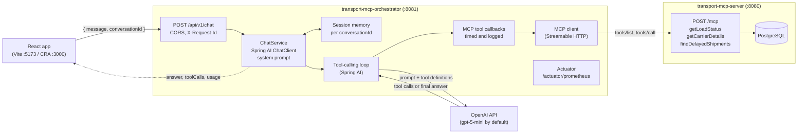
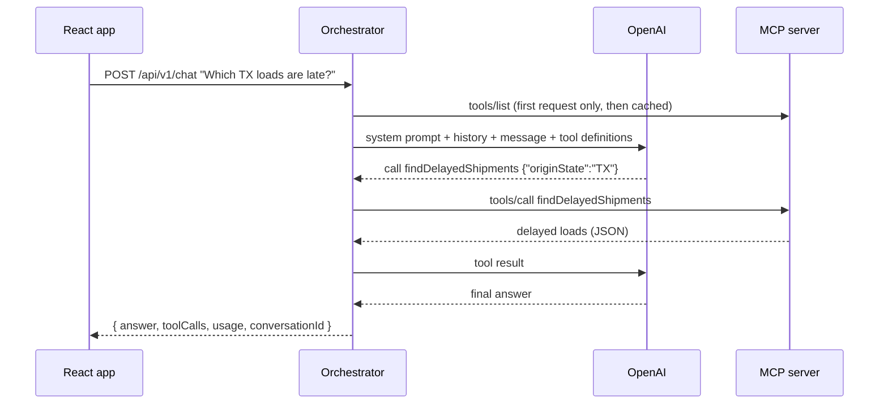

# Transport MCP orchestrator

[](https://github.com/mr-mtd/springboot_mcp_orchestrator/actions/workflows/build.yml)


A chat API for a React front end. The user asks a question in plain words; an OpenAI model reads
the tool list of the [transport MCP server](https://github.com/mr-mtd/springboot_MCP_server),
decides which tools to call and with what arguments, calls them through MCP, and answers from the
results. The orchestrator doesn't know about loads or carriers: whatever tools the MCP server
offers, the model can use.

- Java 21, Spring Boot 4.2, Spring AI 2.1 (OpenAI chat model, MCP client, session memory)
- One endpoint: `POST /api/v1/chat`, on port `8081` (the MCP server is on `8080`)

## How it works





If a tool returns an error (unknown load, bad input, the server's rate limit), the error message
goes back to the model, which explains it or retries with corrected input.

## API

`POST /api/v1/chat`

```json
{ "message": "Where is load 420?", "conversationId": "optional, from the previous reply" }
```

```json
{
  "conversationId": "7a35d7b7-936b-41f9-addc-22ccb431565b",
  "answer": "LD-000420 is in transit with Swift Freight, 3.4 hours late.",
  "model": "gpt-5-mini",
  "toolCalls": [
    { "tool": "getLoadStatus", "arguments": "{\"loadNumber\":\"420\"}", "outcome": "success", "durationMs": 19 }
  ],
  "usage": { "promptTokens": 250, "completionTokens": 50, "totalTokens": 300 },
  "durationMs": 1903
}
```

Send the `conversationId` back to continue the conversation; leave it out to start a new one.
History is kept in memory for an hour and trimmed to the last 10 turns once it passes 20, so it is
lost on restart.

Errors are [RFC 9457](https://www.rfc-editor.org/rfc/rfc9457) problem details: `400` for a blank
or too long message (over 4,000 characters), `503` when the MCP server can't be reached, `502` when
the model call fails.

```js
const res = await fetch("http://localhost:8081/api/v1/chat", {
  method: "POST",
  headers: { "Content-Type": "application/json" },
  body: JSON.stringify({ message, conversationId }),
});
const reply = await res.json(); // keep reply.conversationId for the next message
```

## Configuration

| Variable | Default | Meaning |
| --- | --- | --- |
| `OPENAI_API_KEY` | (required) | OpenAI API key. Never commit it |
| `OPENAI_MODEL` | `gpt-5-mini` | Chat model |
| `MCP_SERVER_URL` | `http://localhost:8080` | Base URL of the transport MCP server (endpoint `/mcp`) |
| `MCP_REQUEST_TIMEOUT` | `20s` | Timeout for each MCP request |
| `CORS_ALLOWED_ORIGINS` | `http://localhost:5173,http://localhost:3000` | Browser origins allowed to call `/api/**` |
| `PORT` | `8081` | HTTP port |
| `LOG_LEVEL` | `INFO` | Level for `io.github.mrmtd.orchestrator` |

The MCP connection opens on the first chat, so the orchestrator starts even when the MCP server is
down. The MCP server rate-limits per session and the orchestrator uses one session, so all users
share that budget; raise the server's `RATE_LIMIT_CAPACITY` for more than light use.

## Logs and metrics

Every line carries the request id (from the front end's `X-Request-Id` header, or generated, and
returned in the response):

```
INFO [req=63da5a38-…] MeteredToolCallback : tool=getLoadStatus outcome=success durationMs=18 arguments={"loadNumber":"420"}
INFO [req=63da5a38-…] ChatService         : chat conversation=a82d58fb-… outcome=success toolCalls=1 promptTokens=250 completionTokens=50 durationMs=84
INFO [req=63da5a38-…] http                : method=POST path=/api/v1/chat status=200 durationMs=87
```

At `/actuator/metrics` and `/actuator/prometheus`:

| Metric | What | Tags |
| --- | --- | --- |
| `gen_ai.client.operation` | LLM call latency (Spring AI) | model, provider |
| `gen_ai.client.token.usage` | tokens (Spring AI) | `gen_ai.token.type` (input, output, total) |
| `orchestrator.chat` | whole chat request, timer with histogram | `outcome` |
| `orchestrator.chat.tokens` | tokens per chat, distribution summary | `type` (prompt, completion) |
| `orchestrator.tool.calls` | each MCP tool call, timer | `tool`, `outcome` |
| `http.server.requests` | HTTP requests (Spring) | `uri`, `status`, ... |

## Run locally

You need **JDK 21**, **Maven 3.9+**, an **OpenAI API key**, and the transport MCP server running.

1. Start the [transport MCP server](https://github.com/mr-mtd/springboot_MCP_server) on port 8080.
   To run it on a local Postgres in Docker:

   ```bash
   git clone https://github.com/mr-mtd/springboot_MCP_server.git && cd springboot_MCP_server
   docker run -d --name transport-db -p 5432:5432 -e POSTGRES_PASSWORD=postgres -e POSTGRES_DB=transport postgres:18
   sed -e 's/CHANGE_ME_1/migrator/' -e 's/CHANGE_ME_2/mcp/' db/roles.sql | docker exec -i transport-db psql -U postgres -d transport
   MIGRATOR_PASSWORD=migrator mvn spring-boot:run -Dspring-boot.run.profiles=migrate
   DB_PASSWORD=mcp mvn spring-boot:run
   ```

2. Start the orchestrator in a second terminal:

   ```bash
   cd springboot_mcp_orchestrator
   export OPENAI_API_KEY=sk-...        # your key; keep it out of the repo
   mvn spring-boot:run
   ```

3. Try it:

   ```bash
   curl -s localhost:8081/api/v1/chat -H 'Content-Type: application/json' \
     -d '{"message":"Which loads from Texas are running late?"}'
   ```

### In Docker

```bash
docker build -t transport-mcp-orchestrator .
docker run --rm -p 8081:8081 -e OPENAI_API_KEY \
  -e MCP_SERVER_URL=http://host.docker.internal:8080 transport-mcp-orchestrator
```

## Tests

```bash
mvn verify      # tests + JaCoCo report at target/site/jacoco/index.html
```

No Docker, database or OpenAI key needed. `ChatIntegrationTest` runs the real Spring AI OpenAI
client against a scripted fake of the OpenAI API, and the real MCP client against an in-process MCP
server built with the MCP Java SDK (same tools and error messages as the transport MCP server). It
checks the tool call round trip, that tool errors go back to the model, conversation history, token
usage, metrics, validation, the `502` on a model failure, and CORS. `McpServerDownTest` checks the
app starts without the MCP server and answers `503`.

GitHub Actions runs `mvn verify` on every push to `main` and `feature/dev` and on every pull
request, writes a test summary, uploads the coverage report, and checks the Docker image builds:
[`.github/workflows/build.yml`](.github/workflows/build.yml).
